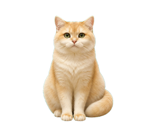
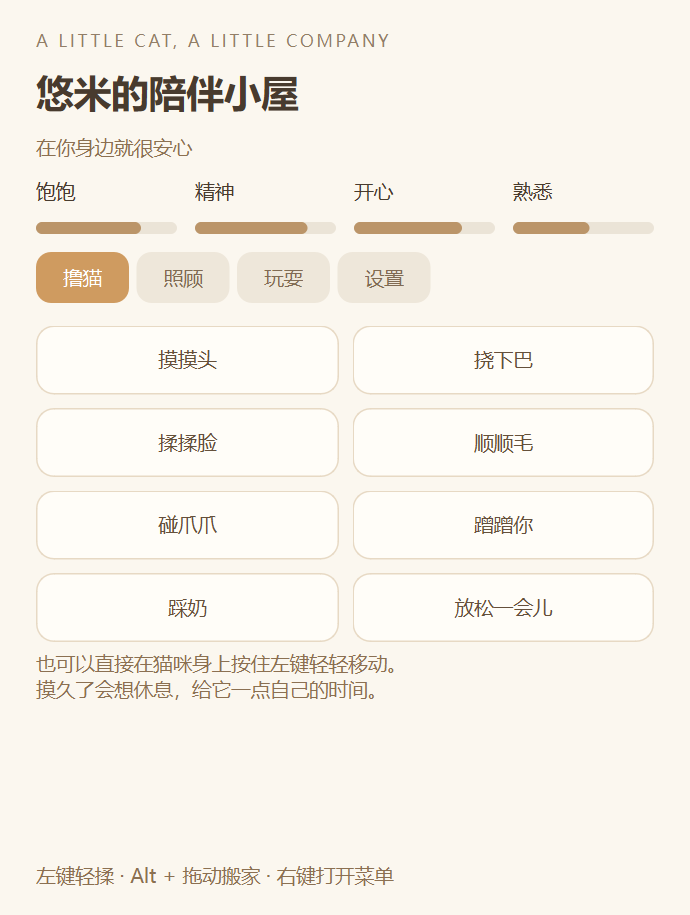

# Yuumi · 悠米桌宠

<p align="center">
  
</p>

一只可以在 Windows 桌面漫步、休息、吃猫粮，也会回应摸头和挠下巴的金渐层。形象根据猫咪照片制作，采用图片驱动动画，支持离线运行和本地存档。

**[下载 Windows 版本](https://github.com/Jiangsir0113/Yuumi/releases)** · **[动作切换预览](docs/media/transitions-64fps.mp4)** · **[构建与测试](docs/DEVELOPMENT.md)**

> **当前构建的 CPU 要求：** v1.2.0 内置 NumPy 2.5.4，需要 `x86-64-v2 / X86_V2` 指令集。部分旧 CPU 或限制指令集的虚拟机无法启动，报错会包含 `NumPy was built with baseline optimizations: (X86_V2)`。低指令集兼容构建尚未验证，详情见[兼容性说明](docs/COMPATIBILITY.md)。

## 功能

| 场景 | 表现 |
| --- | --- |
| 日常陪伴 | 慢走、小跑、坐着眨眼、揣手、蜷睡、打哈欠、伸懒腰、理毛 |
| 撸猫 | 摸头、揉脸、挠下巴、顺背毛、坐姿碰爪、蹭蹭、踩奶 |
| 喂食照顾 | 闻粮、吃粮、吃零食、喝水、舔嘴、洗脸、哄睡和叫醒 |
| 玩耍 | 逗猫棒、伏低、扑抓、滚动小球、抬爪招呼 |
| 一点小脾气 | 摸久了会温柔挡手，休息后恢复；熟悉程度会慢慢增加 |
| 桌面设置 | 调整大小、选择活动屏幕、暂停漫步、全屏隐藏、可选合成呼噜声 |

v1.2 已取消翻肚皮、摸肚皮和原来的侧躺姿势；碰爪互动改为坐姿。

## 动画与交互

- 保留动作及坐下／站起、坐下／揣手、揣手／入睡过渡使用 **64 FPS** 素材。
- 新动作从当前画面与最接近的姿势衔接，支持在过渡中途改向。
- 走路和小跑保留步态相位；速度逐渐变化。
- 新的抚摸可打断吃喝或睡眠，无需先播放完整的旧动作或醒来流程。
- 吃喝按实际持续时间增加饱腹或饮水量；持续抚摸时保持对应反应。

这是生成姿势与像素运动过渡组成的动画，**不是实时 3D 骨骼模型**。素材采样率、程序渲染率和显示器刷新率各不相同，实际流畅度会受硬件和系统负载影响。

## 下载与使用

1. 从 [Releases](https://github.com/Jiangsir0113/Yuumi/releases) 下载 `悠米.exe`。
2. 若旧版本正在运行，先通过猫咪右键菜单或系统托盘选择“退出悠米”。
3. 双击 exe。无需安装 Python；单文件程序首次启动需要几秒解包。

| 操作 | 用途 |
| --- | --- |
| 按住左键轻轻移动 | 对应部位的抚摸 |
| 双击猫咪 | 打开陪伴小屋 |
| 右键 | 喂食、喝水、玩耍、哄睡、显示／隐藏及退出 |
| `Alt` + 左键拖动 | 给猫咪搬家 |
| 托盘菜单 | 找回猫咪、打开小屋或退出 |

猫咪沿当前高度左右漫步，遇到所选屏幕边界会回头。拖动可以改变活动高度，活动屏幕可在设置页选择。

<details>
<summary>陪伴小屋截图</summary>



</details>

## 从源码运行

已验证的开发环境为 **Windows 64 位、Python 3.14 x64**。CPU 要求见[兼容性说明](docs/COMPATIBILITY.md)。

```powershell
git clone https://github.com/Jiangsir0113/Yuumi.git
cd Yuumi
py -3.14 -m venv .venv
.\.venv\Scripts\python.exe -m pip install -r requirements.txt
.\.venv\Scripts\python.exe main.py
```

源码包含运行所需的姿势帧、64 FPS 动画与许可证文件；运行时无需调用图像生成服务。

使用独立开发存档：

```powershell
.\.venv\Scripts\python.exe main.py --state-file qa/dev-state.json --panel
```

## 构建与验证

```powershell
.\.venv\Scripts\python.exe -m unittest discover -s tests -v
.\.venv\Scripts\python.exe build.py --output-dir dist
```

输出为 `dist/悠米.exe`。`build.py` 使用 PyInstaller 打包运行依赖与有效素材，构建日志、临时文件和 exe 不提交到 Git 历史。

v1.2 的本机验证包含 **27 项测试**与 **26 种行为**的独立 exe 检查；具体覆盖范围、性能数字及测试条件记录在[验证说明](docs/VERIFICATION.md)。这不代表所有电脑都已通过兼容性验证。

## 项目结构

```text
main.py                 原生透明窗口、输入、托盘与陪伴小屋
cat_model.py            行为意图、需求变化、抚摸耐受与存档
animation_engine.py     可中断姿势图、相位选择、解码与过渡
benchmarks.py           动作实时性能诊断
assets/                 有效运行素材与动画清单
art-source/             生成姿势源图与提示词记录
tools/                  素材处理、动作编码、预览与验证脚本
tests/                  行为、姿势图和原生界面测试
licenses/               第三方组件许可说明
docs/                   开发说明、兼容性、验证记录与预览
```

## 本地数据

正常存档位置为 `%LOCALAPPDATA%\YoumiDesktop\state.json`，记录名字、大小、位置和熟悉程度等。离线时间不扣照顾分。应用不要求账号，不上传照片或互动记录，也不自动设置开机启动。

## 许可证与素材

原创应用代码采用 [MIT License](LICENSE)。PySide6／Qt、NumPy、OpenCV、Pillow 等依赖保留各自许可证，见 [licenses](licenses/THIRD-PARTY-NOTICES.txt)。

猫咪素材使用 OpenAI imagegen 依据猫咪照片生成。代码的 MIT 许可不自动授予原始照片或角色美术的使用权；使用、替换或再分发角色素材时，请确认相应权利。原始聊天附件、个人存档和开发机器配置不包含在本仓库中。
