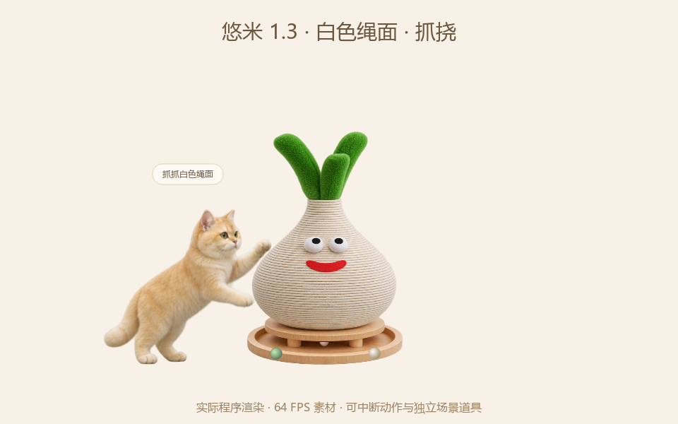

# Yuumi · 悠米桌宠

一只会在 Windows 桌面漫步、休息、吃猫粮，也会回应摸头、挠下巴和玩具的金渐层。照片风格，离线运行，本地存档。

**[下载 v1.3.0](https://github.com/Jiangsir0113/Yuumi/releases/tag/v1.3.0)** · **[查看所有旧版本](https://github.com/Jiangsir0113/Yuumi/releases)** · **[更新日志](CHANGELOG.md)** · **[动作与玩具预览](docs/media/v1.3-preview.mp4)**

<p align="center"></p>

> 当前 Windows x64 构建内置 NumPy 2.5.4，仍需要 `x86-64-v2 / X86_V2` 指令集。本次没有变更 CPU 兼容目标，详见[兼容性说明](docs/COMPATIBILITY.md)。

## v1.3.0 与 v1.2.0 的区别

| 项目 | v1.2.0 | v1.3.0 |
| --- | --- | --- |
| 动画 | 64 FPS 素材，可中断姿势图 | 保持 64 FPS，动态光流移到后台，轻量连续回退；后台解码计入缓存预算 |
| 转向 | 左右站姿之间经过坐姿 | 新增直接站立转身，屏幕边界提前减速 |
| 动作时间 | 身体过渡期间目标动作已开始计时 | 结构进入与目标动作执行分开计时 |
| 抚摸 | 事件时长有最低值，结果受输入频率影响 | 按真实接触时间累计，区分静置、轻抚和快速揉动；冷却期间需要停止接触 |
| 部位与手势 | 按高度分区，按下立即抚摸 | 随当前轮廓、朝向和姿势调整部位；增加边界滞回，双击与抚摸分开处理 |
| 喂食 | 窗口内提示碗，按目标/截止时间进入吃喝 | 食盆独立固定在桌面，实际走到旁边再进食；重复指令不重置路程 |
| 小球与逗猫棒 | 固定目标、定时切换 | 小球保留、滚动、摩擦和反弹；追逐目标随球更新，接触后才拨动；逗猫棒感知鼠标距离和速度 |
| 大蒜猫抓板 | 无 | 白色绳面抓挠；底座圆槽里的三个球独立滚动、碰撞和减速 |
| 陪伴 | 基础需求与熟悉度 | 抚摸偏好记忆、近期动作去重、轻量好奇倾向、玩后整理和疲倦休息 |
| 工作模式 | 常规漫步与全屏隐藏 | 增加安静陪伴、鼠标穿透与托盘恢复；隐藏时停止动画渲染，降低更新频率 |

**旧版本保留：** 每次更新创建新的版本标签和 Release，不覆盖旧 exe、不删除历史发布、不重写历史。需要旧版本时可下载 [v1.2.0](https://github.com/Jiangsir0113/Yuumi/releases/tag/v1.2.0)。

## 下载与启动

1. 在 [v1.3.0 发布页](https://github.com/Jiangsir0113/Yuumi/releases/tag/v1.3.0) 下载 `Yuumi-v1.3.0-windows-x64.exe`，可自行重命名为 `悠米.exe`。
2. 若旧版仍在运行，先用旧版的右键或托盘菜单正常退出。
3. 双击 exe。无需安装 Python；单文件首次启动需要几秒解包。

旧存档会自动读取，名字、大小、熟悉度和需求会保留。离线时间不扣照顾分。

## 撸猫与操作

| 操作 | 效果 |
| --- | --- |
| 在身上按住左键轻轻移动 | 摸头、揉脸、挠下巴、顺毛或碰爪；移动开始后直接响应 |
| 静静按住 | 手放在猫咪身上，刺激低于快速揉动，仍会累计接触时间 |
| 单击 | 在系统双击判定结束后轻轻摸一下 |
| 双击猫咪 | 打开陪伴小屋，不先增加抚摸奖励或取消玩具 |
| `Alt` + 左键拖动 | 给猫咪搬家 |
| 右键 / 系统托盘 | 照顾、玩耍、找回、隐藏和退出 |

摸久了悠米会温柔挡手；松开让它休息后恢复。陪伴小屋可查看饱腹、水分、精力、开心和熟悉程度，也会显示逐渐形成的喜爱部位。

## 大蒜猫抓板

- 在陪伴小屋“玩耍”页或右键菜单选择 **大蒜抓抓板**。
- **点击上部白色绳面**：悠米走到旁边，用前爪交替抓挠。
- **点击底部圆槽 / 选择“拨圆槽小球”**：球沿圆形槽道运动，爪子碰到接触区里的球才会拨动。点击球所在的槽道位置也可给它一点推力。
- **拖动猫抓板**：改变它的桌面位置，悠米会重新靠近。
- **结束**：停止当前互动，道具留在原地。
- **收起**：收起食盆、小球和猫抓板。

圆槽球有碰撞和摩擦；悠米不一定每一爪都能碰到球。抓绳与拨槽球是两种独立行为。互动一会儿会整理毛发，精力不足时会休息。

## 喂食与其他玩具

食盆、水碗和小球都是独立的桌面对象，可以拖动。悠米到达食盆后才开始闻食、吃喝、舔嘴和理毛，食物量根据实际摄入减少。新的抚摸或任务会撤销旧目标，食盆则留在原处。

小球会滚动、减速和碰边反弹，悠米走近后伸爪拨动，再继续追逐。逗猫棒模式下，缓慢移动、快速划过和停住鼠标会影响蓄力节奏；超出可达范围时先观察。使用桌面互动栏的“结束”或托盘菜单停止，不依赖其他应用焦点下的 Esc。

## 安静陪伴与鼠标穿透

- **安静陪伴**：暂停自主漫步、隐藏道具，保留安静姿势。主动开始道具互动会退出此模式。
- **鼠标穿透**：桌宠和道具不拦截鼠标，可从系统托盘取消，或点击托盘把猫咪叫回来。
- **全屏隐藏**：可在设置中开启；隐藏期间不持续渲染动画。
- 呼噜声为可关闭的合成音效，默认关闭。应用不自动设置开机启动。

## 从源码运行与构建

已验证开发目标为 Windows x64、Python 3.14。

```powershell
git clone https://github.com/Jiangsir0113/Yuumi.git
cd Yuumi
py -3.14 -m venv .venv
.\.venv\Scripts\python.exe -m pip install -r requirements.txt
.\.venv\Scripts\python.exe main.py
```

```powershell
.\.venv\Scripts\python.exe -m unittest discover -s tests -v
.\.venv\Scripts\python.exe build.py --output-dir dist
```

构建输出为 `dist/悠米.exe`。使用独立存档开发：`python main.py --state-file qa/dev-state.json --panel`。

详见[开发说明](docs/DEVELOPMENT.md)、[v1.3 验证记录](docs/VERIFICATION-v1.3.md)和[版本发布规则](docs/RELEASING.md)。v1.2 的验证记录仍保留在[原文档](docs/VERIFICATION.md)。

## 实现与数据

```text
main.py                 原生透明窗口、输入、托盘和陪伴小屋
cat_model.py            需求、触摸、偏好、行为选择和存档
animation_engine.py     姿势图、异步解码/光流、相位与过渡
scene_model.py          世界坐标、食盆、小球、猫抓板和活动状态
scene_view.py           独立道具窗口和互动栏
assets/                 姿势帧、64 FPS 动画和猫抓板素材
art-source/             生成源图与提示词记录
tests/                  行为、动画、原生交互与场景测试
tools/                  素材处理、预览、打包验证
```

正常存档位于 `%LOCALAPPDATA%\YoumiDesktop\state.json`。应用离线运行，不要求账号，不上传照片或互动记录。当前是生成姿势与像素过渡组成的二维动画，不是实时 3D 骨骼模型；素材采样率、窗口渲染率和显示器刷新率不同，实际流畅度受设备和负载影响。

## 许可证与素材

原创应用代码采用 [MIT License](LICENSE)。第三方组件许可见 [licenses](licenses/THIRD-PARTY-NOTICES.txt)。猫咪和猫抓板素材由 OpenAI imagegen 依据用户提供的参考生成。MIT 代码许可不自动授予原始照片或角色美术的使用权；使用和再分发素材时请确认相应权利。仓库不包含原始聊天照片、个人存档或开发机器配置。
