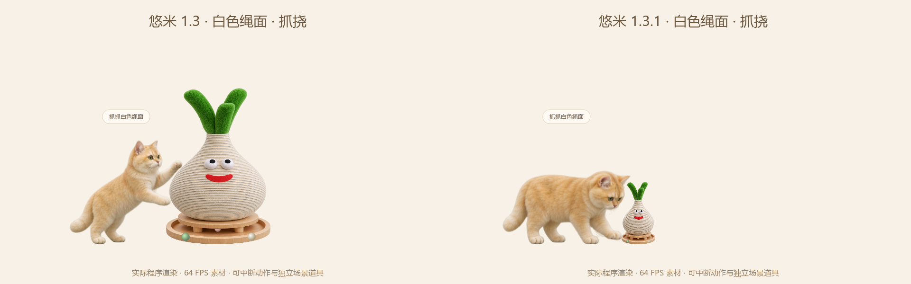

# 猫抓板比例修复

v1.3.0 的抓板图片实际为 413×768，却绘制进固定 220×330 的矩形，横向拉宽约 24%。默认高度也超过了猫咪的可见高度。

v1.3.1 将默认总高度改为 132 个逻辑像素，按原图比例计算宽度，约为 71。绘制阶段再次使用等比适配，避免素材更新后被固定矩形拉伸。不同桌宠大小使用同一缩放因子；绳面、圆槽与落地位置共用几何数据。

猫咪改用低位抓挠，前爪落点与较小抓板同步调整，保留原来的金色尾巴和毛色。

回归检查覆盖 0.65、1、1.5 倍桌宠大小和左右接触。尾色不包含自定义覆盖层。进一步建议见 [IMPROVEMENTS.md](IMPROVEMENTS.md)。
